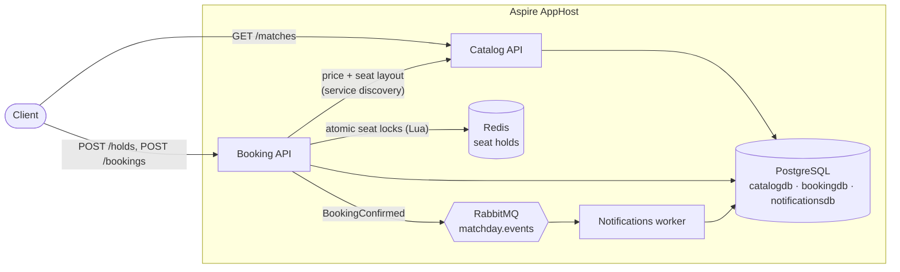
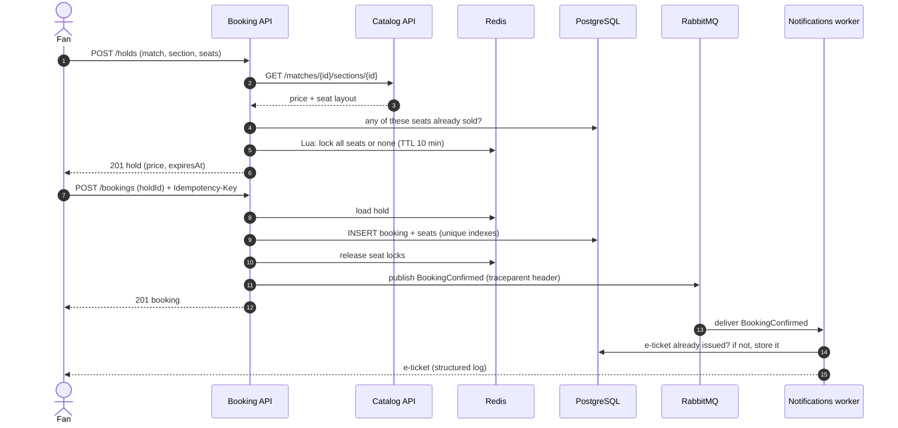
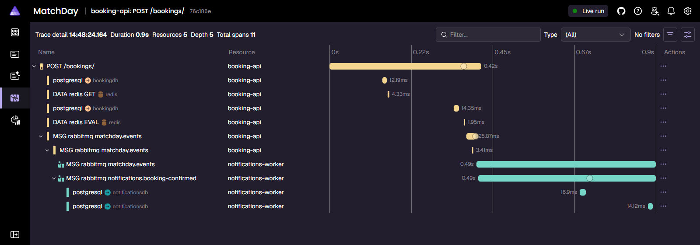
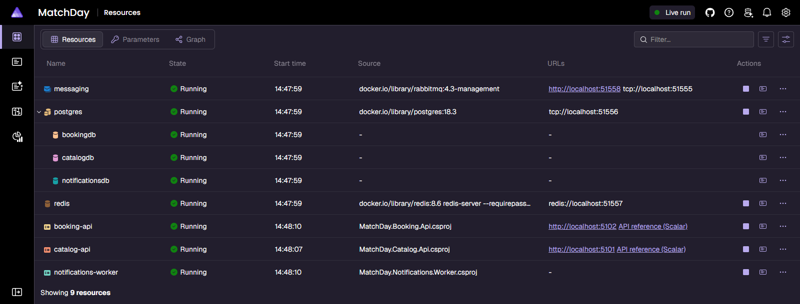

<div align="center">

# MatchDay

**Cloud-native football ticketing on .NET Aspire: hold seats, book them exactly once, and follow every booking from HTTP request to e-ticket in a single trace.**

[](https://github.com/nataliboeva/matchday/actions/workflows/ci.yml)


[](LICENSE)

</div>

MatchDay is the serious sequel to *FoolBallTickets*, my April Fools' joke repository: the same idea, a
ticket shop for football matches, built the way I would build it for production. Fixtures and clubs are
fictional (2026/27 season of an imaginary Bulgarian league); prices are in euro.

## Features

- **Seat holds that can't collide.** Up to 6 seats are held in Redis for 10 minutes. A Lua script checks and
  locks all seats in one atomic step, so two fans clicking the same seat at the same moment can't both get it.
- **Bookings that happen exactly once.** Confirming a hold requires an `Idempotency-Key` header. Retries return
  the original booking, and unique indexes in PostgreSQL are the final guard against double-selling.
- **Prices locked at hold time.** The booking service fetches price and seat layout from the catalog through
  Aspire service discovery, with retries, timeouts and a circuit breaker from the standard resilience handler.
- **Event-driven e-tickets.** A `BookingConfirmed` event goes to RabbitMQ through a small hand-written
  publisher/consumer abstraction (publisher confirms, retry once, dead-letter queue). A worker issues the
  e-ticket idempotently, even if the message is delivered twice.
- **One trace per booking.** W3C trace context travels in the message headers, so the dashboard shows the HTTP
  request, the database writes, the publish and the worker's processing as one trace.
- **Observable by default.** OpenTelemetry logs, traces and metrics for every service, plus a custom
  `matchday.tickets.sold` counter.
- **Consistent APIs.** Minimal APIs with typed results, request validation, `ProblemDetails` for every error,
  and OpenAPI documents with a Scalar UI.

## Architecture



Each service owns its database on a shared PostgreSQL server. Services never share tables; the worker gets
everything it needs from the event itself.

### Booking flow



## Tech stack

| Area | Choice |
| --- | --- |
| Runtime | .NET 10, C# 14, ASP.NET Core Minimal APIs |
| Orchestration | Aspire 13 (AppHost, service defaults, service discovery, dashboard) |
| Data | PostgreSQL with EF Core 10 (Npgsql), Redis via StackExchange.Redis |
| Messaging | RabbitMQ with RabbitMQ.Client 7 and a small in-house abstraction |
| Observability | OpenTelemetry (traces, metrics, logs) exported to the Aspire dashboard |
| API docs | OpenAPI 3.1 (`Microsoft.AspNetCore.OpenApi`) and Scalar |
| Testing | xUnit v3 on Microsoft.Testing.Platform, Shouldly, `Aspire.Hosting.Testing` |
| CI | GitHub Actions on `ubuntu-latest` |

## Getting started

### Prerequisites

- [.NET 10 SDK](https://dotnet.microsoft.com/download) (10.0.300 or newer)
- A container runtime: [Docker Desktop](https://www.docker.com/products/docker-desktop/) or Podman
- Optional: the [Aspire CLI](https://aspire.dev) for `aspire run`

### Run it

```bash
git clone https://github.com/nataliboeva/matchday.git
cd matchday
dotnet run --project src/MatchDay.AppHost
```

or, with the Aspire CLI:

```bash
aspire run
```

The console prints a link to the Aspire dashboard. The first start pulls the PostgreSQL, Redis and RabbitMQ
images, so give it a minute. Everything runs over plain HTTP by default, so no development certificate is
needed; use `dotnet run --project src/MatchDay.AppHost --launch-profile https` if you have a trusted one.

### Book a ticket

The APIs listen on fixed ports: the catalog on `http://localhost:5101` and bookings on `http://localhost:5102`
(each has an API reference at `/scalar`). The `.http` files in each project work in Visual Studio, Rider and
VS Code. With curl:

```bash
# 1. Hold two seats in the Main Tribune for the opening fixture
curl -X POST http://localhost:5102/holds -H "Content-Type: application/json" \
  -d '{"matchId":1,"sectionId":3,"customerEmail":"fan@example.com","seats":[{"row":5,"number":12},{"row":5,"number":13}]}'

# 2. Confirm it (use the holdId from step 1). Sending it again with the same key returns the same booking.
curl -X POST http://localhost:5102/bookings -H "Content-Type: application/json" \
  -H "Idempotency-Key: 6a1f0c2e-5d1b-4a63-9a3e-0d4b7f6c2b11" -d '{"holdId":"<holdId>"}'
```

### API overview

| Service | Endpoint | Description |
| --- | --- | --- |
| Catalog | `GET /matches` | Fixtures ordered by kick-off, with the lowest price |
| Catalog | `GET /matches/{matchId}` | One fixture with its sections and prices |
| Catalog | `GET /matches/{matchId}/sections/{sectionId}` | Price and seat layout of one section |
| Booking | `POST /holds` | Hold 1-6 seats for 10 minutes |
| Booking | `GET /holds/{holdId}` / `DELETE /holds/{holdId}` | Inspect or release a hold |
| Booking | `POST /bookings` | Confirm a hold (requires `Idempotency-Key`) |
| Booking | `GET /bookings/{bookingId}` | Get a booking |
| Booking | `POST /bookings/{bookingId}/cancel` | Cancel before kick-off and release the seats |

Errors are always `application/problem+json`: 400 for invalid input, 404 for unknown matches, holds or
bookings, 409 when seats are taken or a booking rule is broken, and 422 when an idempotency key is reused for
a different hold.

## What to look at in the Aspire dashboard



*A real `POST /bookings` trace: the booking API reads and writes PostgreSQL, touches Redis and publishes to
`matchday.events`; the notifications worker picks the message up from `notifications.booking-confirmed` and
stores the e-ticket. Eleven spans, two services, one trace.*

- **Resources** - three containers (with a database per service) and three .NET projects, each with its
  state. The APIs link to their Scalar reference, and RabbitMQ links to its management UI.
- **Traces** - besides the booking trace above, a `POST /holds` trace shows the booking API calling the
  catalog API through service discovery.
- **Structured logs** - filter by `notifications-worker` to see `E-ticket MD-... sent to f**@example.com`
  with a link to its trace. The stored e-ticket records the same trace id.
- **Metrics** - `matchday.tickets.sold` on `booking-api`, with `matchday.match` and `matchday.section`
  dimensions.



## Running tests

```bash
# Everything (the integration tests need Docker)
dotnet test

# Fast unit tests only: domain rules, pricing, metrics, trace propagation, idempotent e-tickets
dotnet test --project tests/MatchDay.UnitTests

# End-to-end: starts the whole AppHost and books a ticket through every service
dotnet test --project tests/MatchDay.IntegrationTests
```

The integration tests use `DistributedApplicationTestingBuilder` to run the real AppHost with real
containers. They check the full hold, confirm and e-ticket flow (including that the e-ticket carries the
trace id the test started), concurrent holds on the same seat, idempotent retries and sold-out seats. When
Docker isn't running they are skipped with a message saying so.

## Project structure

```text
matchday/
├── src/
│   ├── MatchDay.AppHost/               # Aspire app model: containers, services, wiring
│   ├── MatchDay.ServiceDefaults/       # OpenTelemetry, health checks, discovery, resilience, migrations
│   ├── MatchDay.Catalog.Api/           # Fixtures, stadium sections, prices (EF Core + seed data)
│   ├── MatchDay.Booking.Api/
│   │   ├── Domain/                     # SeatHold, TicketBooking, pricing rules - no infrastructure
│   │   ├── Holds/                      # Redis seat holds (Lua scripts) and /holds endpoints
│   │   ├── Bookings/                   # Confirm/cancel, idempotency, events, metrics
│   │   ├── Catalog/                    # Typed HttpClient for the catalog API
│   │   └── Data/                       # EF Core DbContext and migrations
│   ├── MatchDay.Notifications.Worker/  # BookingConfirmed consumer that issues e-tickets
│   └── MatchDay.Messaging/             # RabbitMQ publisher/consumer, trace propagation, contracts
├── tests/
│   ├── MatchDay.UnitTests/
│   └── MatchDay.IntegrationTests/
├── .github/workflows/ci.yml
├── Directory.Build.props               # Nullable, warnings as errors, code style in build
└── Directory.Packages.props            # Central package management
```

## Design decisions

- **Redis for holds, PostgreSQL for the truth.** Holds are short-lived and contended, which suits Redis with a
  TTL. Sold seats are protected by a partial unique index (`WHERE "IsReleased" = false`) in PostgreSQL, so even
  if Redis is flushed a seat still can't be sold twice; cancelled seats become available again.
- **One Lua script instead of per-seat `SETNX`.** Locking seats one by one can leave a half-held selection when
  the second seat is taken. The script checks every seat first and only then locks them all.
- **Idempotency in the database, not middleware.** The key is a unique column on the booking, which also covers
  two retries racing each other. Reusing a key for a different hold returns 422 instead of silently succeeding.
- **A hand-written messaging layer instead of MassTransit.** It is under 300 lines and shows the parts that
  matter here: publisher confirms, manual acks, retry-once then dead-letter, and trace context in headers.
  It deliberately skips sagas, scheduling and transport abstraction.
- **Publish after commit, no outbox (yet).** If RabbitMQ is down the booking still succeeds and the failure is
  logged, but that e-ticket is not sent. A transactional outbox is the first roadmap item.
- **Self-contained events.** `BookingConfirmed` carries the match, seats and price, so the worker never calls
  other services and keeps working when they are down.
- **Migrations on startup.** Convenient for a demo with one replica per service. In production I would run
  them as a separate deployment step (an EF Core migration bundle).
- **HTTP by default for local runs.** Services talk plain HTTP inside the app model, so cloning and running
  works without trusting a development certificate. The `https` launch profile is still there.

## Roadmap

- [ ] Transactional outbox for `BookingConfirmed`
- [ ] React + TypeScript front end with a seat map and a hold countdown
- [ ] Authentication, so customers only see their own bookings
- [ ] A payment step between hold and confirmation
- [ ] `BookingCancelled` event and cancellation e-mails
- [ ] Real e-mail delivery (the sender is an interface with a logging implementation today)
- [ ] Deployment to Azure Container Apps with `aspire deploy`

## License

[MIT](LICENSE) © 2026 Natali Boeva
